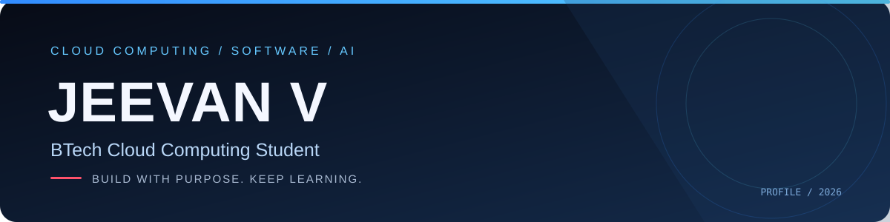
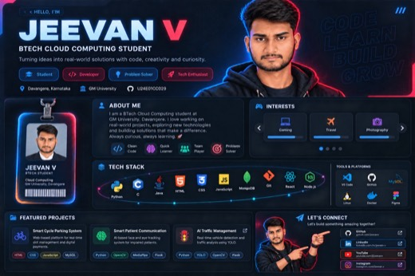

### BTech Cloud Computing Student

**Cloud Computing · Software Development · Artificial Intelligence**

[GitHub](https://github.com/jeevankag2006-tech) · [Repositories](https://github.com/jeevankag2006-tech?tab=repositories)

---

## About

I’m a BTech Cloud Computing student who enjoys learning new technologies and building practical software projects. My interests include web development, cloud technologies, Python, and computer vision.

- 🎓 BTech — Cloud Computing
- 💻 Interested in software development and AI-based applications
- 🚀 Learning by building and improving real-world projects

## Technical Skills

| Area | Technologies |
|---|---|
| Programming | Python, C, JavaScript |
| Web Development | HTML, CSS, Node.js, Express |
| Databases | MySQL, MongoDB |
| AI & Computer Vision | OpenCV, YOLO, MediaPipe |
| Tools | Git, GitHub, VS Code |

## Featured Projects

### Smart Cycle Parking System
A web-based cycle parking platform with slot management, booking, and a payment workflow.

`HTML` `CSS` `JavaScript` `MySQL`

### Smart Patient Communication System
An assistive communication prototype using facial movement and eye-blink detection to help users generate messages.

`Python` `OpenCV` `MediaPipe` `Text-to-Speech`

### AI Traffic Management
A computer-vision project focused on vehicle detection and traffic analysis.

`Python` `YOLO` `OpenCV`

---

**BUILD · LEARN · INNOVATE**

Thanks for visiting my profile.

