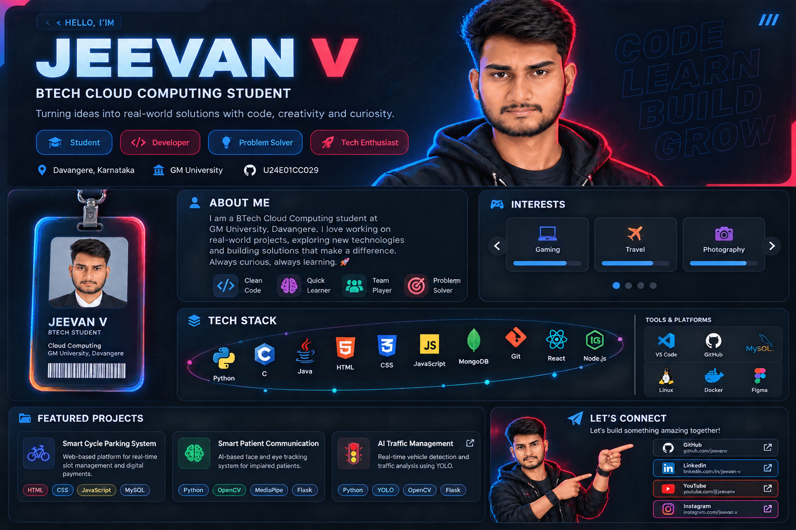

<h1 align="center">Hi, I'm Jeevan V 👋</h1>

<h3 align="center">BTech Cloud Computing Student | Developer</h3>

  Building ideas into real-world projects.

  

---

## 👨‍💻 About Me

- 🎓 BTech Cloud Computing Student
- 🏫 GM University, Davangere
- 💻 Interested in Software Development
- 🚀 Building real-world projects

## 🛠️ Tech Stack

Python | C | Java | HTML | CSS | JavaScript | MongoDB | MySQL | Git

## 🚀 Featured Projects

- Smart Cycle Parking System
- Smart Patient Communication System
- AI Traffic Management System

## 📫 Connect

- GitHub: https://github.com/jeevankag2006-tech

---

BUILD • LEARN • GROW 🚀

