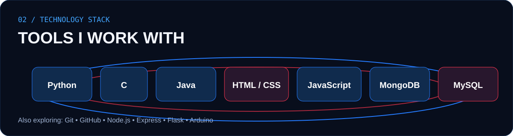
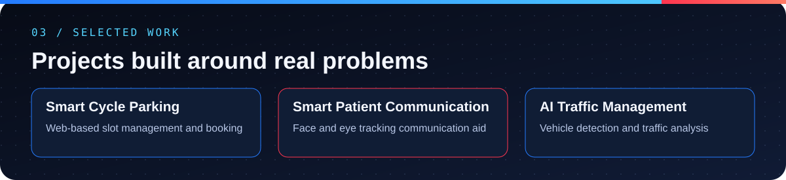
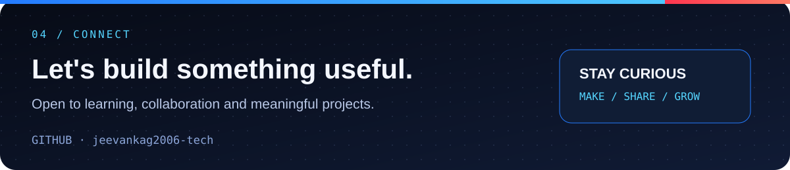

# Jeevan V
### BTech Cloud Computing Student · GM University, Davangere

*Learning by building. Growing through projects.*

---

## Selected Projects

| Project | Focus |
|---|---|
| Smart Cycle Parking System | Web-based parking slot management and booking |
| Smart Patient Communication System | Face and eye tracking assisted communication |
| AI Traffic Management | Vehicle detection and traffic analysis |

## Current interests

- Software and web application development
- Cloud computing and backend systems
- Computer vision and AI-assisted applications
- Building practical student projects

## Connect

- GitHub: [@jeevankag2006-tech](https://github.com/jeevankag2006-tech)

---

**BUILD · LEARN · IMPROVE**

